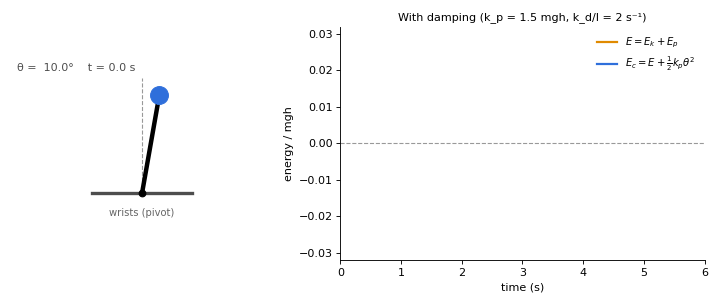

Is a handstand a simple harmonic oscillator? No: left alone, the body simply falls. We need to add to our model *a feedback rule*: in the real world, the feedback comes from the wrists.

 
Toolbox

Symbols. $$\theta$$ is the tilt angle of the body from the vertical and $$\omega = \dot{\theta}$$ its angular velocity. $$m$$ is the body mass, $$h$$ the height of the centre of mass above the wrists, $$I$$ the moment of inertia about the wrists, $$g$$ the gravitational acceleration and $$\tau$$ the torque applied at the wrists.
Feedback control. The corrective torque is computed from the state of the system (here $$\theta$$ and $$\dot{\theta}$$), so that deviations from balance are corrected as they occur.
Restoring torque (active stiffness). The term $$-k_p\theta$$ pushes towards the upright position, like a spring pulling a displaced mass back. The gain $$k_p$$ plays the role of an effective spring constant produced by muscular action.
Damping (dissipation). The term $$-k_d\dot{\theta}$$ opposes motion and dissipates mechanical energy, reducing or eliminating oscillations.
Net stiffness. Gravity acts on the inverted pendulum as a destabilising spring of stiffness $$mgh$$. The stiffness that governs the dynamics is therefore $$k_p - mgh$$.

# A feedback rule: the wrist torque explained

It stays upright only if the effective stiffness is positive ($$k_p > mgh$$) and there is some damping ($$k_d > 0$$).

In [the previous post](https://dopamine-chamber.github.io/2026/10/20/an-energy-perspective.html) we saw that, in our model, the wrists are the only way to change the energy of the body: without a control torque the upright position is the top of a hill. What we have not said yet is how the torque should be produced: to restore equilibrium effectively, corrections must have the right direction, the right size and the right timing. That is where the damped oscillator comes in.

With a feedback by the wrists, the body behaves as a feedback-stabilised inverted pendulum which, for small angles, behaves like a *damped* oscillator: a system pulled back towards equilibrium by a spring-like force, whose swings die out thanks to a damping term, like a car on its shock absorbers. Here, stiffness and damping are produced actively by the muscles. It stays upright only if the effective stiffness is positive ($$k_p > mgh$$) and there is some damping ($$k_d > 0$$).

In practice the wrist torque of the model shows up as pressure shifting between the fingertips and the heel of the hand, which moves the *centre of pressure* under the body. Feedback decides how much to shift, and when.

*Editorial note: Models are elegant, and coming across the different model scientist have provided to formalize the handstand balance is fascinating me very hard. However, models are models, and they only help us understand the mechanics of a handstand, and mechanics tells us which joint torques are needed. Learning to produce them is another matter: it takes strength, mobility and coordination.*

*Technical note: The model we are going to explore mantains the assumptions of the previous posts of the [series](https://dopamine-chamber.github.io/series/):*
*- the body is a single rigid segment pivoting about the wrists*
*- it moves only in the sagittal plane*
*- the tilt angles are small**

## PD control law

To illustrate the mechanism, consider a linear Proportional-Derivative (PD) control law, a feedback rule that combines a term proportional to the error with a term proportional to its rate of change:

$$\tau = -k_p\theta - k_d\dot{\theta}$$

The coefficients (gains) $$k_p$$ and $$k_d$$ are tuning parameters: they set how strongly and how quickly the wrists respond to a perturbation. 

Without control, the linearised equation of motion is $$I\ddot{\theta} = mgh,\theta + \tau$$. With $$\tau = 0$$ the tilt grows exponentially: this is the fall. Substituting the PD law gives

$$I\ddot{\theta} + k_d\dot{\theta} + (k_p - mgh)\theta = 0$$

This is the equation of a damped harmonic oscillator with effective stiffness $$k_p - mgh$$. Its natural frequency and damping ratio are

$$\omega_n = \sqrt{\frac{k_p - mgh}{I}}, \qquad \zeta = \frac{k_d}{2\sqrt{I\,(k_p - mgh)}}$$

<figure>
  
  <figcaption markdown="span">Figure 1. Same natural frequency $$\omega_n$$, three damping ratios $$\zeta$$: underdamped ($$\zeta < 1$$) the body swings while returning to the vertical; critically damped ($$\zeta = 1$$) it returns as fast as possible without swinging; overdamped ($$\zeta > 1$$) it returns slowly without swinging.</figcaption>
</figure>

The body oscillates while returning to the vertical only if $$\zeta < 1$$. For $$\zeta = 1$$ the return is the fastest possible without oscillation, and for $$\zeta > 1$$ it is slower and non-oscillatory. The spring and the damper here are not passive materials: they are the controller, that is, muscles driven by the nervous system.

## Stability conditions

For the upright position ($$\theta = 0$$, $$\dot{\theta} = 0$$) to be asymptotically stable, meaning that the body returns to it after a small disturbance, the gains must satisfy

$$k_d > 0 \qquad \text{and} \qquad k_p > mgh$$

The condition $$k_p > mgh$$ says that the active stiffness produced by the muscles must exceed the destabilising pull of gravity, while $$k_d > 0$$ provides the dissipation. In detail, there are three cases:

If $$k_p < mgh$$, gravity wins and the body falls.
If $$k_p > mgh$$ but $$k_d = 0$$, the body oscillates about the vertical at frequency $$\omega_n$$ without ever settling.
If $$k_p > mgh$$ and $$k_d > 0$$, the body returns to the vertical.

The same conditions can be read from the energy. Take the mechanical energy $$E = \tfrac{1}{2} I \omega^2 + mgh,(\cos\theta - 1)$$, which is zero at the upright position, and add the energy stored in the "control spring":

$$E_c = \tfrac{1}{2} I \omega^2 + mgh\,(\cos\theta - 1) + \tfrac{1}{2} k_p \theta^2$$

The only torque that does work is $$\tau$$, so $$dE/dt = \tau,\omega$$. With the PD law,

$$\frac{dE_c}{dt} = -k_d\,\omega^2 \le 0$$

The derivative term continuously removes energy. Near the vertical,

$$E_c \approx \tfrac{1}{2} I \omega^2 + \tfrac{1}{2}\,(k_p - mgh)\,\theta^2$$

which is positive definite exactly when $$k_p > mgh$$. Since $$E_c$$ cannot increase, the body stays close to the vertical. To show that it actually settles, note that $$dE_c/dt = 0$$ only when $$\omega = 0$$; if $$\omega$$ stayed zero, the equation of motion would force $$(k_p - mgh)\theta = 0$$, that is $$\theta = 0$$. LaSalle's invariance principle then gives asymptotic stability. For the linearised equation this is also immediate: a second-order polynomial with positive coefficients has roots with negative real part.

<figure> <!-- SEO: rename the file to damped-inverted-pendulum-pd-control.gif, update src, and add width/height attributes -->  <figcaption markdown="span">Figure 1. Handstand modelled as an inverted pendulum with PD control and damping ($$k_p > mgh$$, $$k_d > 0$$). The body returns to the vertical (left). The mechanical energy $$E$$ rises and falls as the torque alternately adds and removes energy ($$dE/dt = \tau\omega$$), while $$E_c$$ is non-increasing ($$dE_c/dt = -k_d\omega^2 \le 0$$). Both tend to zero, the energy of the upright equilibrium.</figcaption> </figure>

# Why delay matters in a handstand

Without delay, any $$k_p > mgh$$ and $$k_d > 0$$ would be stable, however large. In reality the sensorimotor loop is slow. Yeadon and Trewartha (2003) studied four male gymnasts and estimated delays of 160 to 240 ms by regressing wrist torque against earlier values of the centre-of-mass position and velocity. These are statistical estimates from a small sample, not direct measurements, so they should be read as an order of magnitude, but they are consistent with long-latency reflexes.

Blenkinsop, Pain and Hiley (2016) later estimated delays of 161 ± 14 ms with a PD model and 188 ± 14 ms when a passive stiffness term was added, close to the forearm EMG latencies of 165 ± 14 ms measured in perturbed handstands. In unperturbed handstands the delays were longer (207 ± 12 ms with eyes open, 220 ± 19 ms with eyes closed).

With a delay, the region of stable gains in the $$(k_p, k_d)$$ plane becomes bounded: gains that are too high destabilise the system as well. In the linear model, over-correcting produces growing oscillations; in a real wrist, where the torque saturates, they become sustained ones. A well-tuned handstand needs enough stiffness, but not too much. For delay effects in human balancing more generally, see Stépán (2009).

To get a feel for the numbers, take illustrative values $$m = 70$$ kg and a centre of mass 1 m above the wrists. Then $$mgh \approx 690$$ N·m/rad: the wrists must supply at least that torque per radian of tilt just to cancel gravity. Treating the body as a uniform rod pivoting at one end, the uncontrolled fall has a time constant of about 0.4 s, only roughly twice the delay. That narrow margin is one reason the handstand is hard. (This is a back-of-the-envelope estimate, not a result from the studies cited.)

# A model, not a law

The PD law is a model of what the nervous system does, and estimates such as the delay depend on the model used: the two Blenkinsop et al. (2016) values above come from two different models of the same data.

The model also has limits. The torque at the wrists is bounded by the size of the contact area under the hands: the centre of pressure cannot leave the hands, so large perturbations cannot always be recovered and the linear model stops being valid. And the wrists are not alone. Yeadon and Trewartha (2003) found that a fixed-configuration strategy accounted for 86% of the variance of both shoulder and hip torques, while Blenkinsop et al. (2017) found the wrist strategy to be the most prevalent in handstand (more than 75% of the time), with strategies used one at a time rather than together. In the next post we will build a more accurate model to capture how the other joints contribute to balance.

[Next post →](https://dopamine-chamber.github.io/2026/10/22/human-body-is-deformable.html)

#### Source and references
- [Loughborough University Repository](https://repository.lboro.ac.uk/articles/journal_contribution/Control_strategy_for_a_hand_balance/9630269?file=17279426){:target="_blank" rel="noopener noreferrer"} - Control strategy for a hand balance
- [Royal Society Open Science](https://royalsocietypublishing.org/rsos/article/4/7/161018/93310/Balance-control-strategies-during-perturbed-and){:target="_blank" rel="noopener noreferrer"} - Balance control strategies during perturbed and unperturbed balance in standing and handstand
- [Teesside University](https://research.tees.ac.uk/en/publications/strategies-for-maintaining-a-handstand-in-the-anterior-posterior-/){:target="_blank" rel="noopener noreferrer"} - Strategies for maintaining a handstand in the anterior-posterior direction
- [Philosophical Transactions of the Royal Society A](https://royalsocietypublishing.org/rsta/article-abstract/367/1891/1195/17515/Delay-effects-in-the-human-sensory-system-during?redirectedFrom=fulltext){:target="_blank" rel="noopener noreferrer"} - Delay effects in the human sensory system during balancing
Figure 1 - Generated via Python for dopamine-chamber.github.io
