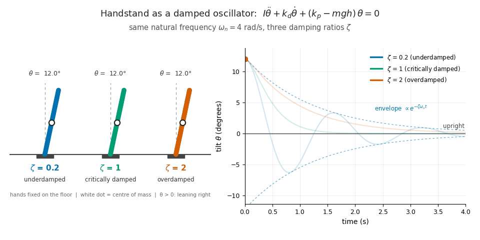

So far, we have tried to describe the motion of the center of mass of our model, the stick figure with all of its mass concentrated at the centre of mass. As we have seen, for good control of a handstand, we aim for this motion to be fine and very precise. Now, we want to describe this motion mathematically in order to study its components: we have seen that it is not possible to obtain harmonic motion from our stick figure without introducing neuromuscular control, because, left on its own, our stick figure falls. This control is a *feedback rule*, which in the real world is exerted by our wrists. What does this feedback rule look like?

 
Toolbox

* $$\theta$$ is the tilt angle of the body from the vertical
* $$\omega = \dot{\theta}$$ its angular velocity
* $$m$$ is the body mass
* $$h$$ the height of the centre of mass above the wrists
* $$I$$ the moment of inertia about the wrists
* $$g$$ the gravitational acceleration
* $$\tau$$ the torque applied at the wrists.
* Feedback control. The corrective torque is computed from the state of the system (here $$\theta$$ and $$\dot{\theta}$$), so that deviations from balance are corrected as they occur.
* Restoring torque (active stiffness). The term $$-k_p\theta$$ pushes towards the upright position, like a spring pulling a displaced mass back. The gain $$k_p$$ plays the role of an effective spring constant produced by muscular action.
* Damping (dissipation). The term $$-k_d\dot{\theta}$$ opposes motion and dissipates mechanical energy, reducing or eliminating oscillations.
* Net stiffness. Gravity acts on the inverted pendulum as a destabilising spring of stiffness $$mgh$$. The stiffness that governs the dynamics is therefore $$k_p - mgh$$.

# A feedback rule: the wrist torque explained

In [the previous post](https://dopamine-chamber.github.io/2026/10/20/an-energy-perspective.html) we saw that, in our model, the wrists are the only way to change the energy of the body: without a control torque the handstand position is *the top of a hill*. To hold the belance effectively, corrections must have the right **direction**, the right **size** and the right **timing**. That is where the damped oscillator comes in.

With a feedback by the wrists, the body behaves as a *feedback-stabilised inverted pendulum* which, for small angles, behaves like a *damped* oscillator: a system pulled back towards equilibrium by a **spring-like force**, whose swings die out thanks to a **damping term**. Here, stiffness and damping are produced actively by the muscles. It stays upright only if the effective stiffness is positive and there is some damping.

In practice, the feedback rule adds a torque that depends on what the body *senses* in terms of angle and angular velocity. Here, the wrist torque of the model shows up as **pressure** shifting between the fingertips and the heel of the hand, which moves the *centre of pressure* under the body. And the feedback decides how much to shift, and when. 

*Editorial note: Models are elegant, and coming across the different model scientist have provided to formalize the handstand balance is fascinating me very hard. However, models are models, and they only help us understand the mechanics of a handstand, and mechanics tells us which joint torques are needed. Learning to produce them is another matter: it takes strength, mobility and coordination.*

*Technical note: The model we are going to explore mantains the assumptions of the previous posts of the [series](https://dopamine-chamber.github.io/series/):*
*- the body is a single rigid segment pivoting about the wrists*
*- it moves only in the sagittal plane*
*- the tilt angles are small**

## What does the feedback rule look like?

To illustrate the mechanism, consider a linear Proportional-Derivative (PD) control law, a feedback rule that combines a term proportional to the error with a term proportional to its rate of change:

$$\tau = -k_p\theta - k_d\dot{\theta}$$

The coefficients (gains) $$k_p$$ and $$k_d$$ are tuning parameters: they set how strongly and how quickly the wrists respond to a perturbation. 

Without control, the linearised equation of motion is $$I\ddot{\theta} = mgh,\theta + \tau$$. With $$\tau = 0$$ the tilt grows exponentially: this is the fall. Substituting the PD law gives:

$$I\ddot{\theta} + k_d\dot{\theta} + (k_p - mgh)\theta = 0$$

This is the equation of a damped harmonic oscillator with effective stiffness $$k_p - mgh$$. Its natural frequency and damping ratio are

$$\omega_n = \sqrt{\frac{k_p - mgh}{I}}, \qquad \zeta = \frac{k_d}{2\sqrt{I\,(k_p - mgh)}}$$

<figure>
  
  <figcaption markdown="span">Figure 1. Same natural frequency $$\omega_n$$, three damping ratios $$\zeta$$: underdamped ($$\zeta < 1$$) the body swings while returning to the vertical; critically damped ($$\zeta = 1$$) it returns as fast as possible without swinging; overdamped ($$\zeta > 1$$) it returns slowly without swinging.</figcaption>
</figure>

Stiffness describes how strongly the body is pushed back towards the vertical in proportion to how far it has tilted. Lean a little and the correction is gentle; lean a lot and it is firm. This is the same rule as a spring: the further you stretch it, the harder it pulls back.

Gravity, on the other hand, acts as a spring with negative stiffness, $$-mgh$$: it pushes the body away from the vertical, and the further it tilts, the harder it pushes. The wrists must therefore provide a spring stiff enough to win this contest, so that the net stiffness $$k_p - mgh$$ stays positive.

Damping describes a force that opposes how fast the body is moving, whatever its position. It works like a shock absorber: without it, a spring keeps bouncing; with it, the bouncing fades away. In a handstand, damping is what stops the body from swaying back and forth ever more widely as it overcorrects.

Unlike stiffness, damping receives no contribution from gravity: gravity depends on the tilt angle, not on its speed. This is why the equation only needs an effective stiffness, while the damping is simply $$k_d$$.

The body oscillates while returning to the vertical only if $$\zeta < 1$$. For $$\zeta = 1$$ the return is the fastest possible without oscillation, and for $$\zeta > 1$$ it is slower and non-oscillatory. The spring and the damper here are not passive materials: they are the controller, that is, muscles driven by the nervous system.

## Stability conditions

For the upright position ($$\theta = 0$$, $$\dot{\theta} = 0$$) to be asymptotically stable (meaning that the body returns to it after a small disturbance), the gains must satisfy

$$k_d > 0 \qquad \text{and} \qquad k_p > mgh$$

The condition $$k_p > mgh$$ says that the active stiffness produced by the muscles must exceed the destabilising pull of gravity, while $$k_d > 0$$ provides the dissipation. In detail, there are three cases:

1. If $$k_p < mgh$$, gravity wins and the body falls.
2. If $$k_p > mgh$$ but $$k_d = 0$$, the body oscillates about the vertical at frequency $$\omega_n$$ without ever settling.
3. If $$k_p > mgh$$ and $$k_d > 0$$, the body returns to the vertical.

Note that the second case is a mathematical idealisation, useful for understanding the role of damping, but the real body never has zero damping: outside the assumptions of the model, even if the neural control provided no derivative term at all, the real body would still have passive damping *by construction*. This damping lies in the *viscosity of muscles and tendons, the internal friction of joints and soft tissues, and the deformation of the skin and hand in contact with the ground*. 

In the model these effects add to $$k_d$$, so the total damping is always greater than zero. An oscillation that never dies out would require a system with no energy dissipation at all, and no biological system is like that.

## Energy derivation with PD control

Instead of solving the equation of motion, we can ask a simpler question: does the energy of the system go up or down? If it can only go down, and it has a single minimum at the balanced handstand, the body cannot drift away from it.

Without control,  the body is a rigid stick, with hips, shoulders and spine held fixed, pivoting about the wrists. Its mechanical energy is:

$$E = \tfrac{1}{2} I \omega^2 + mgh\,(\cos\theta - 1)$$

where the first term is the kinetic energy and the second is the gravitational potential energy: the centre of mass sits at height $$h\cos\theta$$ above the wrists, and we subtract the constant $$mgh$$ so that $$E = 0$$ in the perfectly balanced handstand. As soon as the body tilts, $$\cos\theta < 1$$ and this term becomes negative: *tilting lowers the centre of mass*. The balanced handstand is therefore the top of a hill, not the bottom of a valley, which is why a handstand held with fully relaxed wrists collapses.

Adding the control spring, the proportional part of the wrist torque, $$-k_p\theta$$, behaves like a spring, and a spring stores energy $$\tfrac12 k_p\theta^2$$. In the real handstand, this torque appears as extra pressure on the fingertips or on the heel of the hand, depending on which way the body leans. Adding the spring energy gives

$$E_c = \tfrac{1}{2} I \omega^2 + mgh\,(\cos\theta - 1) + \tfrac{1}{2} k_p \theta^2$$

($$E_c$$ is a bookkeeping quantity rather than the physical energy of the body.)

How the energy changes? Gravity is already included in $$E$$ as potential energy, so the only torque that does work is the wrist torque $$\tau$$, and $$dE/dt = \tau,\omega$$. With the PD law $$\tau = -k_p\theta - k_d\omega$$, the spring term of $$E_c$$ cancels the $$k_p$$ part exactly, leaving

$$\frac{dE_c}{dt} = -k_d\,\omega^2 \le 0$$

The proportional part does not dissipate energy: it only exchanges it with the motion, like a real spring. The derivative part, which reacts to how fast the body is tilting, continuously removes energy whenever the body moves, like a brake.

Near the vertical, $$\cos\theta - 1 \approx -\theta^2/2$$, so

$$E_c \approx \tfrac{1}{2} I \omega^2 + \tfrac{1}{2}\,(k_p - mgh)\,\theta^2$$

This is positive for every state except $$\theta = \omega = 0$$ (it is positive definite) exactly when $$k_p > mgh$$. In that case $$E_c$$ has the shape of a bowl with its bottom at the balanced handstand; otherwise the balanced handstand is a peak. Since $$E_c$$ can never increase, the body can never climb the walls of the bowl, so it stays close to the vertical. This property is called stability.

Does it actually settle? Staying close to the vertical does not yet mean coming to rest there. The energy stops decreasing, $$dE_c/dt = 0$$, not only at equilibrium but whenever $$\omega = 0$$, even with $$\theta \neq 0$$, because a brake does nothing to a body that is momentarily still, for example at the extreme of a sway. However, the body cannot remain still away from the vertical: if $$\omega$$ stayed zero, $$\dot\omega$$ would be zero too, and the linearised equation of motion would give $$(k_p - mgh),\theta = 0$$, that is $$\theta = 0$$. Anywhere else, a net torque restarts the motion and the brake acts again. LaSalle’s invariance principle makes this argument rigorous: if the energy cannot increase and the motion stays bounded, the system converges to the largest set on which the energy remains constant and which the system cannot leave. Here that set is the balanced handstand alone, so the body returns to the vertical (asymptotic stability).

A quick check: for the linearised equation $$I\ddot\theta + k_d\dot\theta + (k_p - mgh)\theta = 0$$, the solutions are combinations of $$e^{st}$$, where $$s$$ solves $$Is^2 + k_d s + (k_p - mgh) = 0$$. When all the coefficients are positive, both roots have a negative real part (their sum is $$-k_d/I < 0$$ and their product is positive), so every solution decays to zero. This gives the same conditions: $$k_p > mgh$$ and $$k_d > 0$$.

<figure> <!-- SEO: rename the file to damped-inverted-pendulum-pd-control.gif, update src, and add width/height attributes -->  <figcaption markdown="span">Figure 2. Handstand modelled as an inverted pendulum with PD control and damping ($$k_p > mgh$$, $$k_d > 0$$). The body returns to the vertical (left). The mechanical energy $$E$$ rises and falls as the torque alternately adds and removes energy ($$dE/dt = \tau\omega$$), while $$E_c$$ is non-increasing ($$dE_c/dt = -k_d\omega^2 \le 0$$). Both tend to zero, the energy of the upright equilibrium.</figcaption> </figure>

# Why delay matters in a handstand

Without delay, any $$k_p > mgh$$ and $$k_d > 0$$ would be stable, however large. In reality the sensorimotor loop is slow. Yeadon and Trewartha (2003) studied four male gymnasts and estimated delays of 160 to 240 ms by regressing wrist torque against earlier values of the centre-of-mass position and velocity. These are statistical estimates from a small sample, not direct measurements, so they should be read as an order of magnitude, but they are consistent with long-latency reflexes.

Blenkinsop, Pain and Hiley (2016) later estimated delays of 161 ± 14 ms with a PD model and 188 ± 14 ms when a passive stiffness term was added, close to the forearm EMG latencies of 165 ± 14 ms measured in perturbed handstands. In unperturbed handstands the delays were longer (207 ± 12 ms with eyes open, 220 ± 19 ms with eyes closed).

With a delay, the region of stable gains in the $$(k_p, k_d)$$ plane becomes bounded: gains that are too high destabilise the system as well. In the linear model, over-correcting produces growing oscillations; in a real wrist, where the torque saturates, they become sustained ones. A well-tuned handstand needs enough stiffness, but not too much. For delay effects in human balancing more generally, see Stépán (2009).

To get a feel for the numbers, take illustrative values $$m = 70$$ kg and a centre of mass 1 m above the wrists. Then $$mgh \approx 690$$ N·m/rad: the wrists must supply at least that torque per radian of tilt just to cancel gravity. Treating the body as a uniform rod pivoting at one end, the uncontrolled fall has a time constant of about 0.4 s, only roughly twice the delay. That narrow margin is one reason the handstand is hard. (This is a back-of-the-envelope estimate, not a result from the studies cited.)

# A model, not a law

The PD law is a model of what the nervous system does, and estimates such as the delay depend on the model used: the two Blenkinsop et al. (2016) values above come from two different models of the same data.

The model also has limits. The torque at the wrists is bounded by the size of the contact area under the hands: the centre of pressure cannot leave the hands, so large perturbations cannot always be recovered and the linear model stops being valid. And the wrists are not alone. Yeadon and Trewartha (2003) found that a fixed-configuration strategy accounted for 86% of the variance of both shoulder and hip torques, while Blenkinsop et al. (2017) found the wrist strategy to be the most prevalent in handstand (more than 75% of the time), with strategies used one at a time rather than together. In the next post we will build a more accurate model to capture how the other joints contribute to balance.

[Next post →](https://dopamine-chamber.github.io/2026/10/22/human-body-is-deformable.html)

#### Source and references
- [Loughborough University Repository](https://repository.lboro.ac.uk/articles/journal_contribution/Control_strategy_for_a_hand_balance/9630269?file=17279426){:target="_blank" rel="noopener noreferrer"} - Control strategy for a hand balance
- [Royal Society Open Science](https://royalsocietypublishing.org/rsos/article/4/7/161018/93310/Balance-control-strategies-during-perturbed-and){:target="_blank" rel="noopener noreferrer"} - Balance control strategies during perturbed and unperturbed balance in standing and handstand
- [Teesside University](https://research.tees.ac.uk/en/publications/strategies-for-maintaining-a-handstand-in-the-anterior-posterior-/){:target="_blank" rel="noopener noreferrer"} - Strategies for maintaining a handstand in the anterior-posterior direction
- [Philosophical Transactions of the Royal Society A](https://royalsocietypublishing.org/rsta/article-abstract/367/1891/1195/17515/Delay-effects-in-the-human-sensory-system-during?redirectedFrom=fulltext){:target="_blank" rel="noopener noreferrer"} - Delay effects in the human sensory system during balancing
Figure 1 - Generated via Python for dopamine-chamber.github.io
