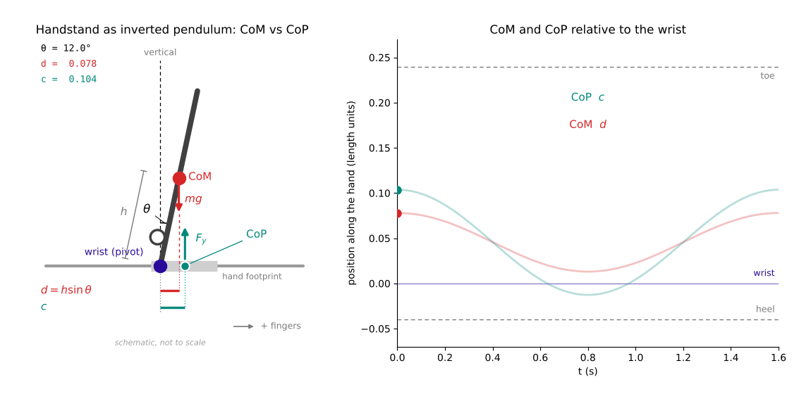
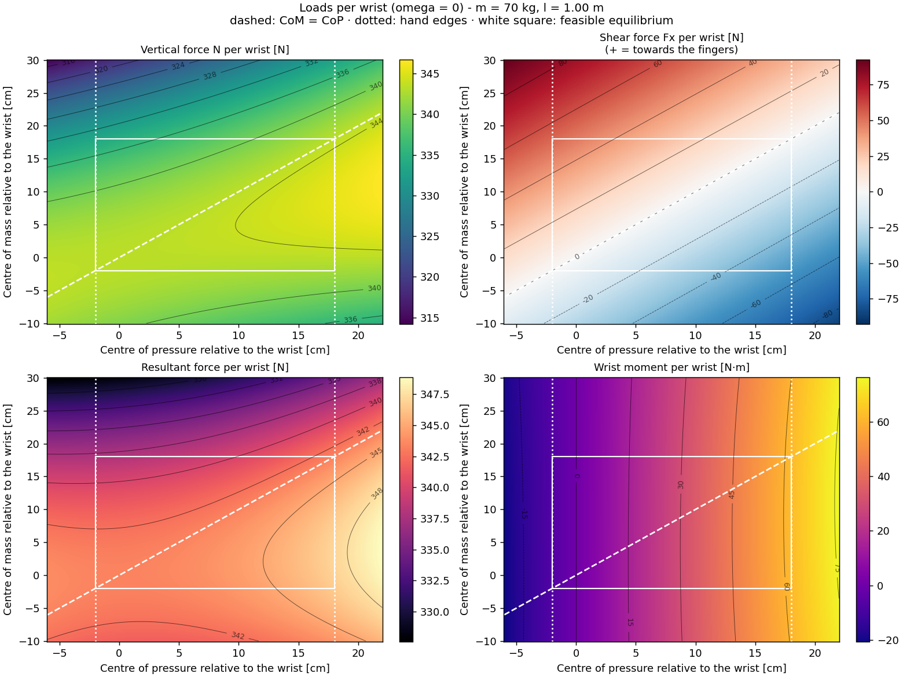
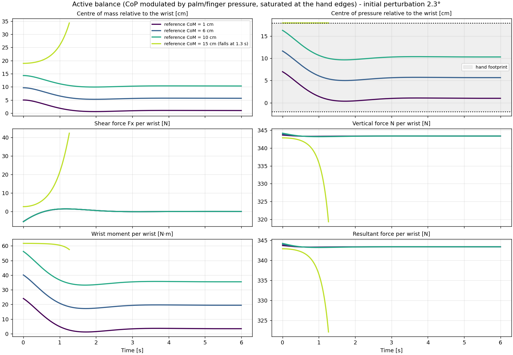
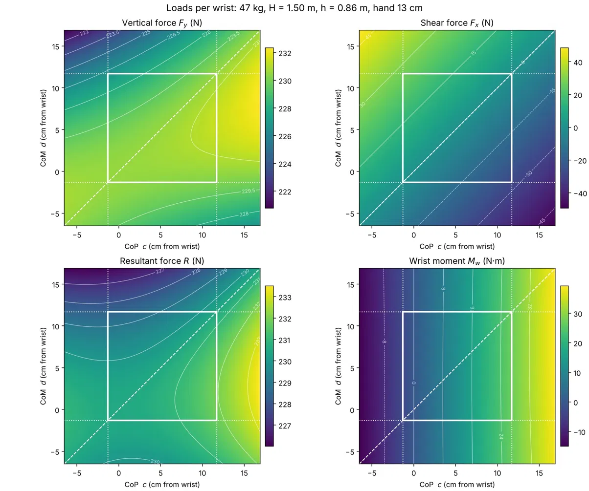

There comes a moment, in the course of your practice, when you have to do something with everything you've learned from theory. Take what you're told by one person or another and make it your own experience, understand whether it's true, whether it works for you. The systems the human body uses to cope with gravity, the muscles, the nervous system, the antigravity myofascial chains, work well and, if all goes well, work the same way for everyone. They're the ones that let you walk, live, move. But when there's such an important cognitive component, as in the handstand, there is no perfect protocol. *You have to embody it*. 

To gravity, at a certain point, you adapt: you have the tools to do it. It's the context that changes. It's about *understanding where control stops being external and starts being internal*. 

## An hypothesis about the world

In my [previous posts](2026/10/20/an-energy-perspective.html) we have analyzed the model representing the handstand problem, unpacking why this system is unstable—both from a mechanical and force-balance perspective and from an energetic one. In particular, the energetic interpretation makes it even clearer that **stability is negotiated** and that active control is required for the handstand to happen. This torque is the wrist torque and here is how we framed it:

$$
|\tau| = mgh\sin\theta
$$

First result: the magnitude of the torque depends on the tilt $$\theta$$ and on the height $$h$$ of the centre of mass. Which means it also depends on *how tall you are*.

In practice, everything we have done so far is analyze which force, which external element is responsible for a fall—what makes us fragile, and whether some variables carry more weight than others. All of this is useful, yet it is nothing more than a hypothesis of the world we want to move in—a world that, let’s remember, is not as ideal as the one we are modeling. In short, it’s a nice story: coherent and interesting, sure, but it’s not the whole picture. At some point, the outside world meets the inner world. 

The study of balance strategies brings out the importance of another element called the **centre of pressure** (CoP), which is the point of application where all the ground reaction forces from the floor converge. In practice, it's the point of contact with the world, the point of passage from passive to active, where gravity goes from being something you endure to something you manage. The centre of pressure comes out of gait analysis and postural studies, but it applies just as well to the handstand.

We’ll pretend to make meet outside and inside worls right here: the moment we stop looking at what happens to our center of mass and start paying attention to what we feel on the palms of our hands, the only point where we can actually act, and through them, perhaps, bring our center of mass back under control.

## Control theory: a negotiation between the body, the environment, the task

Let’s give all this unapologetically mathematical talk a deep, individual, neuromuscular meaning. To manage gravity, the body uses joint strategies depending on how gross the movement we need to correct is, relying on the ankles, hips and knees. In the case of the handstand, of course, the joint most called upon is the wrists, and this strategy is called **the wrist strategy** among several studies of the handstand itself, which have examined how balance is maintained and controlled in the anterior–posterior direction. It's not always like this, obviously things are more complicated than that. But these studies, conducted among experienced athletes, have shown that wrist strategy is actually the most commonly used to recover balance when the centre of mass is swaying outside its stability range. So we can make one more assumption, and pretend we’re referring to experienced athletes who rely primarily on this control strategy.

This is the strategy we've seen so far, with the rigid-body assumptions we've made up to now, in which nothing else moves or creates levers or twists. And remembering our other usual assumptions, the body is a rigid stick of mass $$m$$ and length $$H$$ rotating about the wrist, with the centre of mass (CoM) at distance $$h$$ from the pivot.

Let:

- $$\theta$$ be the inclination from the vertical (positive towards the fingers);
- $$d = h\sin\theta$$ the horizontal position of the CoM relative to the wrist;
- $$c$$ the position of the CoP under the hand, also relative to the wrist.

The CoP can only lie within the hand footprint.This is where the problem changes character: once the CoP is introduced, balance is no longer only about where the body is, but also about where the body is able to push against the ground (Figure 1).

<figure>
  
  <figcaption markdown="span">
    Figure 1. Centre of mass (CoM), centre of pressure (CoP) and hand footprint.
  </figcaption>
</figure>

At every instant, the model is defined by two quantities:

- the position of the **centre of mass (CoM)** relative to the wrists, determining how gravity tends to tilt the body
- the position of the **centre of pressure (CoP)** under the hands, that determines where the ground reaction force acts

Think of a handstand as a constant tug-of-war between two points: your CoM (where gravity pulls you down) and your CoP (where the floor pushes you back up through your hands). Together, these two positions tell the whole story of what your body is doing at any given instant.

Usually, writing out the physics of a handstand gets messy because of all the unknown internal forces acting inside the wrist joint. However, we can use a mathematical trick: if we choose the wrist as our pivot point when calculating rotational forces (torques), those unknown joint forces mathematically cancel out. 

In out model, positive shear force is defined toward the fingers, that is, in the direction of the body's horizontal acceleration. Since the model is symmetric, the total load is assumed to be shared equally between the two hands, and all reported values refer to a single wrist.
Around the wrist, gravity pulls the CoM forward (at horizontal distance $$d = h\sin\theta$$) with a tipping torque $$mg\,d$$, while the ground reaction force pushes up at the CoP (at distance $$c$$) with a counter-torque $$F_y\,c$$. That gives us the rotational equation for angular acceleration $$\ddot{\theta}$$:

$$I\ddot{\theta} = mg\,d - F_y\,c$$

Meanwhile, linear motion links the body’s acceleration to the external forces: 
* horizontally: $$m\ddot{x}_{\text{CoM}} = F_x$$ (with $$\ddot{x}_{\text{CoM}}$$ coming from the geometry of $$\theta$$)
* vertically, $$m\ddot{y}_{\text{CoM}} = F_y - mg$$

Combining these lets us isolate $$\ddot{\theta}$$ from the positions of the CoM and CoP—and once we know how the body is accelerating, we can plug that acceleration right back in to solve for the forces and wrist torque.

In practical terms, this means we don't need to measure complex internal muscle tensions to see what is happening. Just by knowing your body’s lean and where you feel pressure under your palms, the model immediately tells us whether you are falling forward or backward, how fast, and what that move demands from the wrists.

Four quantities are monitored:

- the *vertical force* $$F_y$$ ($$N$$), which supports body weight;
- the *shear force* $$F_x$$, acting parallel to the ground;
- the *resultant force* $$R=\sqrt{F_x^2+F_y^2}$$;
- the *wrist moment* $$M_w$$, representing the torque that must be sustained by the wrist structures and surrounding muscles.

## The heat map: the space where you can feel the balance

Rather than evaluating the equations for only one posture, we solve them across an entire grid of CoM and CoP locations. The result is a map showing how wrist loads shift throughout the balance space, revealing not only whether a posture is dynamically stable, but also how costly it is for the wrists (Figure 2).

To ground the math in a concrete athlete, we start with a reference model:

* Body mass $$m$$: 70 kg (body weight 687 N, 343 N per wrist)
* Wrist-to-CoM distance $$h$$: 1.00 m
* Body height $$H$$: 1.75 m
* Hand length: 20 cm
* Hand footprint: 2 cm behind the wrist to 18 cm in front of it

<figure>
  
  <figcaption markdown="span">
    Figure 2. Heat maps of the vertical force, shear force, resultant force and wrist moment as functions of CoP and CoM. Loads per wrist as functions of CoP (horizontal axis) and CoM (vertical axis), both relative to the wrist. Dashed line: CoM = CoP. Dotted lines: hand edges. White square: region where equilibrium is feasible, with CoM and CoP both inside the hand.
  </figcaption>
</figure>

Explaining these four panels:

#### 1. The white square: where balance lives
{: style="text-align: left;"}

Start with the white square in the middle of each panel. It defines the entire region where balance is physically possible, with both CoM and CoP inside the hand footprint:

* To correct a **forward fall**, the CoP must move in front of the CoM by pressing through the fingers
* To correct a **backward fall**, the CoP must move behind the CoM by loading the heel of the hand
{: style="text-align: left;"}

Whether you actually have that correction available depends on how much physical room remains between your CoM and the edges of your hand. As we will see next, *this geometric boundary turns out to be even more limiting than the raw magnitude of the forces themselves*.

#### 2. In static equilibrium, your wrists carry torque (not extra vertical weight)
{: style="text-align: left;"}

Along the dashed diagonal, the CoM sits vertically above the CoP ($$d = c$$) and the body does not accelerate:

$$
F_x = 0
$$

and

$$
M = \frac{mg}{2}c \approx 3.4\ \text{N·m per cm of } c.
$$

Putting the CoP at 9 cm gives about 30.9 N·m per wrist, whereas pushing all the way to the fingertips (18 cm) roughly doubles that to 62 N·m. Look at the lower-right panel: the iso-lines run vertically. That tells us the wrist moment depends primarily on the CoP position itself, so even when perfectly balanced, holding farther toward the fingers directly increases the torque your wrists and forearm muscles have to sustain.

#### 3. Away from equilibrium, shear force takes over
{: style="text-align: left;"}

As soon as the CoM and CoP separate, horizontal shear force ($$F_x$$) becomes the key player. Its iso-lines run parallel to the diagonal $$d = c$$ because, to first approximation, it is the offset between the two positions:

$$
d - c
$$

that drives it:

- zero on the diagonal ($$d = c$$)
- positive when the CoM is ahead of the CoP (tipping toward the fingers)
- negative when the CoM is behind the CoP

Near equilibrium, every centimetre of offset adds roughly 2.7 N of shear force per wrist—so a 5 cm offset produces about 14 N, and doubling the offset roughly doubles the shear force too.

#### 4. Vertical force barely flinches
{: style="text-align: left;"}

Interestingly, vertical force ($$F_y$$) is far less sensitive. Across most of the feasible region, it stays close to the static 343 N per wrist, shifting by only a few percent. In other words, big differences in wrist loading come mainly from **wrist moments and shear forces**, not from dramatic swings in vertical force.

To see how balance behaves in motion, we simulate a small forward nudge from rest: an initial tilt of $$0.04\ \mathrm{rad}$$ (about $$2.3^\circ$$, or roughly 4 cm of horizontal CoM shift). We test four starting CoM positions along the hand and consider a trial a fall if body tilt passes $$0.35\ \mathrm{rad}$$ (about $$20^\circ$$), tracking both the body’s trajectory and the resulting wrist loads.

<figure>
  
  <figcaption markdown="span">
    Figure 3. Active balance with a saturated CoP controller after an initial perturbation of 2.3°, for four reference CoM positions (1, 6, 10 and 15 cm). Grey band: hand footprint.
  </figcaption>
</figure>

Three clear takeaways stand out:

* 1, 6, and 10 cm recover cleanly. Their dynamic transients are nearly identical, shear force stays under roughly 6 N per wrist, and the baseline wrist moment simply scales at about 3.4 N·m per centimetre of reference CoM
* 15 cm falls after about 1.3 seconds. Braking the nudge would require moving the CoP to roughly 21 cm—beyond the 18 cm fingertip edge—so the controller saturates and can no longer save the balance
* once a fall begins, the plotted loads lose physical meaning because the model assumes a flat hand on the floor

The key lesson here is sharp: failure isn’t caused by excessive force, because the loads remain modest. Failure happens because the needed CoP lies outside the hand footprint—it is a controllability limit, not a strength limit.

## Failure mode: the handstand collapse

A nudge of 4 cm is just one test. How far can the body lean before recovery becomes impossible? What is the **recoverable balance margin**, the largest initial lean from rest that can still be saved? Expressing this limit as horizontal CoM displacement (in centimetres) makes robustness intuitive: it shows how far your CoM can drift from its reference spot and still be brought back inside the hand.

<table style="width: 100%; border-collapse: collapse; background-color: #ffffff; color: #111111; margin: 1.5em 0;">
  <thead>
    <tr style="background-color: #ffffff; border-bottom: 1.5px solid #222222;">
      <th style="text-align: left; padding: 8px 4px; background-color: #ffffff;">Reference CoM</th>
      <th style="text-align: left; padding: 8px 4px; background-color: #ffffff;">Max forward recovery</th>
      <th style="text-align: left; padding: 8px 4px; background-color: #ffffff;">Max backward recovery</th>
      <th style="text-align: left; padding: 8px 4px; background-color: #ffffff;">Wrist moment at reference</th>
    </tr>
  </thead>
  <tbody>
    <tr style="background-color: #ffffff; border-bottom: 1px solid #eeeeee;">
      <td style="padding: 8px 4px; background-color: #ffffff;">3 cm</td>
      <td style="padding: 8px 4px; background-color: #ffffff;">15.0 cm</td>
      <td style="padding: 8px 4px; background-color: #ffffff;">5.0 cm</td>
      <td style="padding: 8px 4px; background-color: #ffffff;">10.3 N·m</td>
    </tr>
    <tr style="background-color: #ffffff; border-bottom: 1px solid #eeeeee;">
      <td style="padding: 8px 4px; background-color: #ffffff;">8 cm (mid-hand)</td>
      <td style="padding: 8px 4px; background-color: #ffffff;">10.0 cm</td>
      <td style="padding: 8px 4px; background-color: #ffffff;">10.0 cm</td>
      <td style="padding: 8px 4px; background-color: #ffffff;">27.5 N·m</td>
    </tr>
    <tr style="background-color: #ffffff; border-bottom: 1px solid #eeeeee;">
      <td style="padding: 8px 4px; background-color: #ffffff;">9 cm</td>
      <td style="padding: 8px 4px; background-color: #ffffff;">9.0 cm</td>
      <td style="padding: 8px 4px; background-color: #ffffff;">11.0 cm</td>
      <td style="padding: 8px 4px; background-color: #ffffff;">30.9 N·m</td>
    </tr>
    <tr style="background-color: #ffffff; border-bottom: 1.5px solid #222222;">
      <td style="padding: 8px 4px; background-color: #ffffff;">15 cm</td>
      <td style="padding: 8px 4px; background-color: #ffffff;">3.0 cm</td>
      <td style="padding: 8px 4px; background-color: #ffffff;">17.0 cm</td>
      <td style="padding: 8px 4px; background-color: #ffffff;">51.5 N·m</td>
    </tr>
  </tbody>
</table>

  <strong>Table 1.</strong> Recoverable CoM displacement (within ~0.1 cm resolution) and baseline wrist moment per wrist across four reference CoM positions.

The rule is remarkably clean: your forward recovery margin matches the distance from your reference CoM to the fingertips, and your backward margin matches the distance to the heel of the hand. Balance is recoverable as long as the CoM can still be pulled back within the hand footprint.

* At mid-hand (8 cm): forward and backward margins are equal (**10.0 cm** each) at a moderate wrist moment of about **27.5 N·m** per wrist
* Closer to the wrist: wrist moment drops, but backward recovery room shrinks
* Closer to the fingers: wrist moment rises, and forward recovery room shrinks

Once again, the trade-off is clear: *lower wrist load and wider balance margins do not peak at the same posture.*

## Another hypothesis about *my* world

In the handbalancing world, ask whether taller people struggle more with handstands and the answer arrives almost before the question finishes—obvious, settled, woven into gym lore. This brings us back to the quiet thread running beneath the whole article: does body height really matter, or are we just looking at a different kind of weather?

As someone who loves learning through experience, I need to measure this rather than merely inherit it. So let’s trace the heat maps again—our balance space—through my own coordinates: 47 kg, 150 cm tall, CoM at 0.86 m from the wrist, and a 13 cm hand footprint (from roughly -1.3 cm behind the wrist to +11.7 cm at the fingertips).

<figure>
  
  <figcaption markdown="span">
    Figure 4. Heat maps of vertical force ($$F_y$$), shear force ($$F_x$$), resultant force ($$R$$), and wrist moment ($$M_w$$) per wrist for a 47 kg athlete ($$H = 1.50\text{ m}$$, $$h = 0.86\text{ m}$$, hand footprint from about $$-1.3\text{ cm}$$ to $$+11.7\text{ cm}$$). Dashed line: CoM = CoP. Dotted lines: hand edges. White square: feasible balance region.
  </figcaption>
</figure>

On the force side, the discount is immediate: static vertical load drops to around 230 N per wrist, and even reaching all the way to the fingertips (11.7 cm) costs roughly 27 N·m of wrist moment—less than what the 70 kg model pays near mid-hand. At the same time, the white square narrows to a 13 cm window (only 6.5 cm of symmetric margin from its center at 5.2 cm), and a lower CoM means faster angular acceleration whenever you drift. The result is a handstand that is physically much more economical, yet geometrically much more demanding than the 70 kg model. Put simply, your handstand lives in a regime where strength costs almost nothing, but precision is everything.

Wander from that small frame into the math of height and the picture shifts subtly. Gravitational torque scales with the distance $$h$$ between the wrist and the centre of mass:

$$
\tau_g
=
mgh\sin\theta.
$$

For the same lean angle, a larger $$h$$ asks for more torque. For small angles, horizontal CoM displacement is approximately

$$
d \approx h\theta,
$$

so the same tilt carries the centre of mass farther out when the body is taller. Because the hand footprint remains roughly fixed, a given CoP travel corresponds to a narrower angular span:

$$
\theta_{\max}
\approx
\frac{L_{\text{hand}}}{h},
$$

where $$L_{\text{hand}}$$ is the effective range available to the centre of pressure.

At first glance, this confirms the gym wisdom that tall bodies face a steeper climb. Yet rotational dynamics wander into a slightly different truth. Rotational inertia grows with height as

$$
I \approx mh^2.
$$

Combining gravitational torque and inertia gives

$$
\ddot{\theta}
=
\frac{g}{h}\theta,
$$

and a characteristic instability rate of

$$
\omega_n
=
\sqrt{\frac{g}{h}}.
$$

As $$h$$ increases, that rate softens: a taller athlete does not necessarily fall faster in angular terms, because rotational inertia grows faster than gravitational torque. What shrinks is not the clock ticking down your reaction, but the angular range that wrist strategy alone can reclaim. Height, then, reshapes the geometry of control more than the speed of the fall itself.

So it’s not that one person has to work harder to control the handstand than the other—it’s that they have to do a different kind of work. We need to understand our own model and adopt control strategies that fit it: build good hypotheses about our world, and interact with it using the most efficient tools.

[Next post →](https://dopamine-chamber.github.io/2026/10/25/handstand-balance-damped-oscillator.html)

#### Source and references

<a href="https://www.circoteca.cl/wp-content/uploads/2019/08/Strategies-for-maintaining-a-handstand-in-the-anterior-posterior-direction-Revista-Ingles-DAVID-G.-KERWIN-GRANT-TREWARTHA-2001.pdf" target="_blank" rel="noopener noreferrer">
    University of Bath
</a> - Strategies for Maintaining a Handstand in the Anterior-Posterior Direction 
<a href="[[https://www.circoteca.cl/wp-content/uploads/2019/08/Strategies-for-maintaining-a-handstand-in-the-anterior-posterior-direction-Revista-Ingles-DAVID-G.-KERWIN-GRANT-TREWARTHA-2001.pdf" target="_blank" rel="noopener noreferrer](https://researchportal.bath.ac.uk/en/publications/control-strategy-for-a-hand-balance/)](https://pdfs.semanticscholar.org/b379/f56f1e52bd017e071ae18fde94f536c2a6d3.pdf)">
   Loughborough University
</a> - Control strategy for a hand balance

