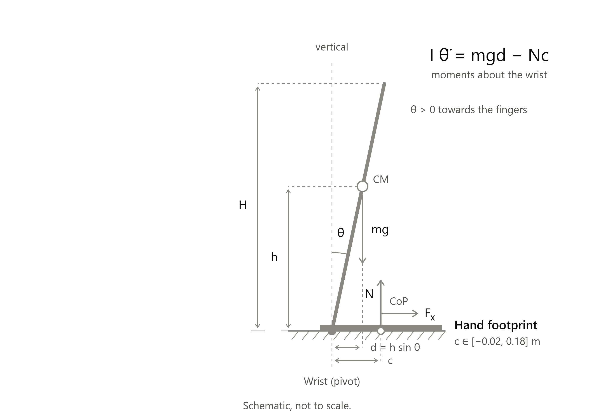

There comes a moment, in the course of your practice, when you have to do something with everything you've learned from theory. Take what you're told by one person or another and make it your own experience, understand whether it's true, whether it works for you. The systems the human body uses to cope with gravity, the muscles, the nervous system, the antigravity myofascial chains, work well and, if all goes well, work the same way for everyone. They're the ones that let you walk, live, move. But when there's such an important cognitive component, as in the handstand, there is no perfect protocol. *You have to embody it*. 

To gravity, at a certain point, you adapt: you have the tools to do it. It's the context that changes. It's about *understanding where control stops being external and starts being internal*. 

## An hypothesis about the world

In my [previous posts](2026/10/20/an-energy-perspective.html) we have analyzed the model representing the handstand problem, unpacking why this system is unstable—both from a mechanical and force-balance perspective and from an energetic one. In particular, the energetic interpretation makes it even clearer that **stability is negotiated** and that active control is required for the handstand to happen. This torque is the wrist torque and here is how we framed it:

$$
|\tau| = mgh\sin\theta
$$

First result: the magnitude of the torque depends on the tilt $$\theta$$ and on the height $$h$$ of the centre of mass. Which means it also depends on *how tall you are*.

In practice, everything we have done so far is analyze which force, which external element is responsible for a fall—what makes us fragile, and whether some variables carry more weight than others. All of this is useful, yet it is nothing more than a hypothesis of the world we want to move in—a world that, let’s remember, is not as ideal as the one we are modeling. In short, it’s a nice story: coherent and interesting, sure, but it’s not the whole picture. At some point, the outside world meets the inner world. 

The study of balance strategies brings out the importance of another element called the **centre of pressure** (CoP), which is the point of application where all the ground reaction forces from the floor converge. In practice, it's the point of contact with the world, the point of passage from passive to active, where gravity goes from being something you endure to something you manage. The centre of pressure comes out of gait analysis and postural studies, but it applies just as well to the handstand.

We’ll pretend to make meet outside and inside worls right here: the moment we stop looking at what happens to our center of mass and start paying attention to what we feel on the palms of our hands, the only point where we can actually act, and through them, perhaps, bring our center of mass back under control.

## Control theory: a negotiation between the body, the environment, the task

Let’s give all this unapologetically mathematical talk a deep, individual, neuromuscular meaning. To manage gravity, the body uses joint strategies depending on how gross the movement we need to correct is, relying on the ankles, hips and knees. In the case of the handstand, of course, the joint most called upon is the wrists, and this strategy is called **the wrist strategy** among several studies of the handstand itself, which have examined how balance is maintained and controlled in the anterior–posterior direction. It's not always like this, obviously things are more complicated than that. But these studies, conducted among experienced athletes, have shown that wrist strategy is actually the most commonly used to recover balance when the centre of mass is swaying outside its stability range. So we can make one more assumption, and pretend we’re referring to experienced athletes who rely primarily on this control strategy.

This is the strategy we've seen so far, with the rigid-body assumptions we've made up to now, in which nothing else moves or creates levers or twists. And remembering our other usual assumptions, the body is a rigid stick of mass $$m$$ and length $$H$$ rotating about the wrist, with the centre of mass (CoM) at distance $$h$$ from the pivot.

## Another hypothesis about the world

Let:

- $$\theta$$ be the inclination from the vertical (positive towards the fingers);
- $$d = h\sin\theta$$ the horizontal position of the CoM relative to the wrist;
- $$c$$ the position of the CoP under the hand, also relative to the wrist.

The CoP can only lie within the hand footprint.This is where the problem changes character: once the CoP is introduced, balance is no longer only about where the body is, but also about where the body is able to push against the ground (Figure 1).

<figure>
  
  <figcaption markdown="span">
    Figure 1. Centre of mass (CoM), centre of pressure (CoP) and hand footprint.
  </figcaption>
</figure>

At every instant, the model is defined by two quantities:

- the position of the **centre of mass (CoM)** relative to the wrists, determining how gravity tends to tilt the body
- the position of the **centre of pressure (CoP)** under the hands, that determines where the ground reaction force acts

Think of a handstand as a constant tug-of-war between two points: your CoM (where gravity pulls you down) and your CoP (where the floor pushes you back up through your hands). Together, these two positions tell the whole story of what your body is doing at any given instant.

Usually, writing out the physics of a handstand gets messy because of all the unknown internal forces acting inside the wrist joint. However, if we choose the wrist as our pivot point when calculating rotational forces (torques), those unknown joint forces mathematically cancel out. Around the wrist, gravity pulls the CoM forward (at horizontal distance $d = h\sin\theta$) with a tipping torque $mg\,d$, while the ground reaction force pushes up at the CoP (at distance $c$) with a counter-torque $F_y\,c$. That gives us the rotational equation for angular acceleration $\ddot{\theta}$:

$$I\ddot{\theta} = mg\,d - F_y\,c$$

Meanwhile, linear motion links the body’s acceleration to the external forces: horizontally, $m\ddot{x}_{\text{CoM}} = F_x$ (with $\ddot{x}_{\text{CoM}}$ coming from the geometry of $\theta$); vertically, $m\ddot{y}_{\text{CoM}} = F_y - mg$. Combining these lets us isolate $\ddot{\theta}$ from the positions of the CoM and CoP—and once we know how the body is accelerating, we can plug that acceleration right back in to solve for the forces and wrist torque.

In practical terms, this means we don't need to measure complex internal muscle tensions to see what is happening. Just by knowing your body’s lean and where you feel pressure under your palms, the model immediately tells us whether you are falling forward or backward, how fast, and what that move demands from the wrists.

Four quantities are monitored:

- the **vertical force** $F_y$ ($N$), which supports body weight;
- the **shear force** $F_x$, acting parallel to the ground;
- the **resultant force** $R=\sqrt{F_x^2+F_y^2}$;
- the **wrist moment** $M_w$, representing the torque that must be sustained by the wrist structures and surrounding muscles.

-----

Positive shear force is defined toward the fingers, that is, in the direction of the body's horizontal acceleration.

Since the model is symmetric, the total load is assumed to be shared equally between the two hands, and all reported values refer to a single wrist.

Rather than evaluating the equations for only one posture, they are solved over a grid of CoM and CoP locations.

This produces a map showing how wrist loads change throughout the balance space.

The resulting maps reveal not only whether a posture is dynamically stable, but also how costly it is for the wrists.

If we initially set the parameters:

| Parameter | Value |
|:---|:---|
| Body mass $$m$$ | 70 kg (body weight 687 N, 343 N per wrist) |
| Wrist-to-CoM distance $$h$$ | 1.00 m |
| Body height $$H$$ | 1.75 m |
| Hand length | 20 cm |
| Hand footprint | 2 cm behind the wrist to 18 cm in front of it |

we obtain the maps shown in Figure 2.

<figure>
  
  <figcaption markdown="span">
    Figure 2. Heat maps of the vertical force, shear force, resultant force and wrist moment as functions of CoP and CoM. Loads per wrist as functions of CoP (horizontal axis) and CoM (vertical axis), both relative to the wrist. Dashed line: CoM = CoP. Dotted lines: hand edges. White square: region where equilibrium is feasible, with CoM and CoP both inside the hand.
  </figcaption>
</figure>

Several things become immediately visible.

In static equilibrium the wrist is loaded mainly by a moment, not by extra force.

When the CoM is vertically above the CoP ($$d=c$$), the body does not accelerate:

$$
F_x = 0
$$

and

$$
M = \frac{mg}{2}c
\approx
3.4\ \text{N·m per cm of } c.
$$

A CoP at 9 cm gives about 30.9 N·m per wrist, whereas a CoP at the fingertips (18 cm) gives roughly 62 N·m.

The lower-right panel makes this particularly clear: the iso-lines are vertical.

The wrist moment depends primarily on the CoP position itself. In equilibrium, where the CoM and CoP coincide, balancing farther toward the fingers directly increases the moment sustained by the wrists.

Away from equilibrium, a different quantity becomes important.

The shear force depends almost entirely on the offset between CoM and CoP.

Its iso-lines run parallel to the diagonal $$d=c$$ because, to first approximation, it is the difference

$$
d-c
$$

that matters.

The shear force is:

- zero on the diagonal;
- positive when the CoM is ahead of the CoP;
- negative when it is behind.

Near equilibrium it is approximately 2.7 N per centimetre of offset, per wrist.

An offset of 5 cm produces about 14 N of shear force; doubling the offset approximately doubles the shear force as well.

Interestingly, the vertical force is much less sensitive.

Throughout most of the feasible region it remains close to the static value of 343 N per wrist, varying by only a few percent.

In other words, large differences in wrist loading arise mainly through moments and shear forces, not through large changes in vertical force.

The white square identifies something even more important than equilibrium.

It defines the entire space where balance can exist.

To correct a forward fall, the CoP must move in front of the CoM by pressing through the fingers.

To correct a backward fall, the CoP must move behind the CoM by loading the heel of the hand.

The availability of those corrections depends entirely on how much room remains between the CoM and the boundaries of the hand footprint.

As we will see next, this geometric limitation turns out to be more important than the actual magnitude of the forces.

## How the centre of pressure is controlled

The maps above tell us what happens for any combination of CoM and CoP positions.

The next question is how the body actually moves the CoP.

Balance is achieved by shifting the centre of pressure underneath the hands. Physiologically, this corresponds to changing the pressure applied by the palm and fingers against the floor.

When the body starts to fall towards the fingers, the fingers press harder into the ground and shift the CoP forwards. When the body falls back towards the palm, finger pressure decreases and the CoP moves backwards.

In this way, the performer continuously manipulates the location of the ground reaction force to generate corrective torques.

In the model, the commanded CoP position is generated by a simple feedback controller:

$$
c_{\mathrm{cmd}}
=
k_p\theta + k_d\dot{\theta}
$$

and is then saturated so that it remains within the physical footprint of the hand.

The proportional term $$k_p$$ responds to body lean: the farther the body moves away from the reference posture, the more the pressure distribution shifts.

The derivative term $$k_d$$ responds to angular velocity and acts as a damping mechanism, counteracting rapid motion before large body angles develop.

The controller should not be interpreted as a measured representation of human motor control. Rather, it is a simplified way of representing the combined action of the fingers, palm, forearm muscles and nervous system.

The gains are therefore illustrative and chosen only to reproduce plausible balancing behaviour.

From a biomechanical perspective, moving the CoP is equivalent to changing finger and palm pressure.

The model therefore captures the essential mechanism of handstand balance: rather than moving the hands, the performer continuously shifts the point of application of the ground reaction force inside the hand footprint, generating corrective moments that oppose the fall.

## Active balance

The equations of motion are integrated using a fourth-order Runge-Kutta scheme with a time step of 1 ms over a simulation horizon of 6 s.

Each trial starts from rest with an initial angular offset of

$$
0.04\ \mathrm{rad}
$$

(approximately \(2.3^\circ\)), corresponding to roughly 4 cm of horizontal CoM displacement from the reference posture.

Four different reference CoM positions are considered.

A trial is classified as a fall when the body angle exceeds

$$
0.35\ \mathrm{rad}
$$

(about \(20^\circ\)).

This threshold represents the point at which balance can no longer be recovered within the assumptions of the model.

For every simulated posture, the model evaluates the resulting angular motion together with the corresponding wrist forces and moments.

This makes it possible to compare not only whether a handstand can be maintained, but also how the required wrist loading changes with body geometry, CoM location and controller behaviour.

<figure>
  
  <figcaption markdown="span">
    Figure 3. Active balance with a saturated CoP controller after an initial perturbation of 2.3°, for four reference CoM positions (1, 6, 10 and 15 cm). Grey band: hand footprint.
  </figcaption>
</figure>

Three results stand out.

Reference positions of 1, 6 and 10 cm are recovered, and the transients of $$F_x$$ and $$N$$ are almost identical in the three cases.

Shear stays below about 6 N per wrist.

The reference position only shifts the baseline of the wrist moment, which settles at about 3.4 N·m per centimetre of reference CoM.

The 15 cm case behaves differently.

After about 1.3 seconds the system falls.

The correction requires a CoP of approximately 21 cm, beyond the 18 cm fingertip edge, so the controller saturates and can no longer restore balance.

This observation is important.

Failure is not caused by excessive force.

The forces and moments remain relatively modest.

Failure occurs because the required centre of pressure lies outside the available hand footprint.

In other words, the limiting factor is not strength but controllability.

Once the fall begins, the plotted forces no longer have a physical meaning, because the model assumes a flat hand and ceases to be valid.

## How far can the body lean before recovery becomes impossible?

The previous simulations determine whether a given perturbation can be recovered.

A natural question therefore follows:

*how far can the body lean before recovery becomes impossible?*

To quantify this, we define the **recoverable balance margin** as the largest initial perturbation from which the controller is still able to restore balance.

For a given reference CoM position, the maximum recoverable forward and backward lean is found numerically using a bisection search.

Starting from a range of initial angular offsets known to contain the recovery threshold, successive simulations progressively narrow the interval until the boundary between recovery and fall is identified.

The procedure uses 14 bisection iterations, with the equations of motion integrated for 6 s using a time step of 2 ms.

Rather than reporting this threshold as an angle, the result is expressed as the corresponding horizontal displacement of the CoM, measured in centimetres.

This provides a more intuitive measure of balance robustness: it directly indicates how far the centre of mass can move from its reference position while still remaining recoverable.

Table 1 gives the largest CoM displacement from which balance is recovered, starting from rest, to within the numerical resolution of the bisection (about 0.1 cm).

| Reference CoM | Max recoverable displacement, forwards | Max recoverable displacement, backwards | Wrist moment at the reference |
| :--- | :--- | :--- | :--- |
| 3 cm | 15.0 cm | 5.0 cm | 10.3 N·m |
| 8 cm (mid-hand) | 10.0 cm | 10.0 cm | 27.5 N·m |
| 9 cm | 9.0 cm | 11.0 cm | 30.9 N·m |
| 15 cm | 3.0 cm | 17.0 cm | 51.5 N·m |

**Table 1.** Recoverable CoM displacement and wrist moment for four reference CoM positions.

A simple pattern immediately emerges.

In every case, the forward margin equals the distance from the reference CoM to the fingertip edge.

Likewise, the backward margin equals the distance to the heel edge.

Within the cases tested, balance is recoverable exactly as long as the CoM can still be brought back within the hand footprint.

The two margins become equal at mid-hand (8 cm), where the wrist moment is approximately 27.5 N·m per wrist.

Balancing closer to the wrist reduces the wrist moment but leaves little room to correct a backward fall.

Balancing closer to the fingers increases the wrist moment and leaves little room to correct a forward fall.

The familiar trade-off appears again.

Lower wrist loading and larger balance margins are not necessarily achieved at the same posture.

## The real question: does height matter?

The previous results reveal something surprising.

The model does not fail because forces become excessively large.

It fails when the required CoP can no longer be placed where the controller needs it.

This brings us back to the question raised at the beginning of the article:

**does body height matter?**

At first sight, the answer seems obvious.

The gravitational torque scales with the distance between the wrist and the centre of mass:

$$
\tau_g
=
mgh\sin\theta.
$$

For the same lean angle, increasing $$h$$ increases the torque that must be controlled.

<figure>
  
  <figcaption markdown="span">
    Figure 4. The hand footprint changes little between individuals, whereas the distance between the wrist and the centre of mass can change substantially.
  </figcaption>
</figure>

For small angles,

$$
d \approx h\theta.
$$

The same angular lean therefore produces a larger horizontal displacement of the centre of mass when the body is taller.

Because the hand footprint remains approximately fixed, the available CoP travel corresponds to a smaller angular range.

A useful approximation is

$$
\theta_{\max}
\approx
\frac{L_{\text{hand}}}{h},
$$

where $$L_{\text{hand}}$$ is the effective range available to the centre of pressure.

This seems to support the common intuition that taller people should struggle more.

But the dynamics tell a more nuanced story.

The rotational inertia also increases with height:

$$
I \approx mh^2.
$$

Combining gravitational torque and inertia gives

$$
\ddot{\theta}
=
\frac{g}{h}\theta.
$$

The characteristic instability rate is therefore

$$
\omega_n
=
\sqrt{\frac{g}{h}}.
$$

As $$h$$ increases, the instability develops more slowly.

A taller athlete does not necessarily fall faster.

In angular terms, the motion is actually slower because inertia grows faster than gravitational torque.

The disadvantage appears elsewhere.

What becomes smaller is not the time available to react, but the angular range that can be corrected through wrist strategy alone.

<figure>
  
  <figcaption markdown="span">
    Figure 5. The same hand footprint corresponds to a smaller admissible angular deviation when the centre of mass is farther from the wrist.
  </figcaption>
</figure>

The model therefore suggests that body height primarily affects the geometry of control rather than the speed of the instability itself.

## So, do taller people struggle more?

Within the assumptions of this model, the answer is both yes and no.

A taller athlete does not fall faster.

If anything, the angular instability develops more slowly because rotational inertia grows faster than gravitational torque.

However, the hand footprint does not increase in proportion to body size.

The centre of pressure can only move within a limited range, and that range corresponds to a progressively smaller angular correction margin as the distance between the wrist and the centre of mass increases.

The model therefore predicts that taller athletes possess less angular authority from wrist control alone.

They do not fail because the body accelerates more violently.

They fail because they reach the geometric limits of the hand sooner.

In this framework, the limiting factor is not force but controllability.

## How good is the model?

Ultimately, the model is a model.

The wrist is at ground level, the hand mass is neglected and the hand stays flat.

The body is represented as a single inverted pendulum with one degree of freedom, ignoring active corrections at the shoulders, hips and knees.

The parameters used here (mass, distance $$h$$, body length, hand footprint and controller gains) are plausible but not measured.

The controller is idealised.

There is no sensory delay, no noise and no actuator dynamics.

The centre of pressure responds instantly to the control command within its limits.

There is also no experimental validation.

The model has not been compared against force-plate measurements or kinematic recordings from real performers.

The recoverable-margin simulations evaluate initial displacement from rest only.

They do not examine disturbances with initial angular velocity, which would significantly reduce the recoverable envelope in practice.

While the model suggests that taller athletes experience a geometric disadvantage, real performers possess additional strategies that are absent here.

Changes in shoulder position, finger stiffness, scapular control, hip compensation and even hand placement may all contribute to extending the practical limits of balance.

These mechanisms remain outside the scope of the present model and would require a more complete multi-segment description of the body.

In the next post we will see exactly that.

A richer model, capable of incorporating additional joints and balance strategies.

There is, however, one methodological lesson worth keeping.

Throughout the analysis, the force acting on the wrist barely changes, while the wrist moment changes substantially.

Studies that report only force magnitude or pressure under the hand would therefore miss most of what actually changes with posture in this model.

The moment, which depends not only on how much force is applied but also on where it is applied, turns out to be the more informative quantity.

#### Source and references

<a href="https://www.circoteca.cl/wp-content/uploads/2019/08/Strategies-for-maintaining-a-handstand-in-the-anterior-posterior-direction-Revista-Ingles-DAVID-G.-KERWIN-GRANT-TREWARTHA-2001.pdf" target="_blank" rel="noopener noreferrer">
    University of Bath
</a> - Strategies for Maintaining a Handstand in the Anterior-Posterior Direction 
<a href="[[https://www.circoteca.cl/wp-content/uploads/2019/08/Strategies-for-maintaining-a-handstand-in-the-anterior-posterior-direction-Revista-Ingles-DAVID-G.-KERWIN-GRANT-TREWARTHA-2001.pdf" target="_blank" rel="noopener noreferrer](https://researchportal.bath.ac.uk/en/publications/control-strategy-for-a-hand-balance/)](https://pdfs.semanticscholar.org/b379/f56f1e52bd017e071ae18fde94f536c2a6d3.pdf)">
   Loughborough University
</a> - Control strategy for a hand balance

